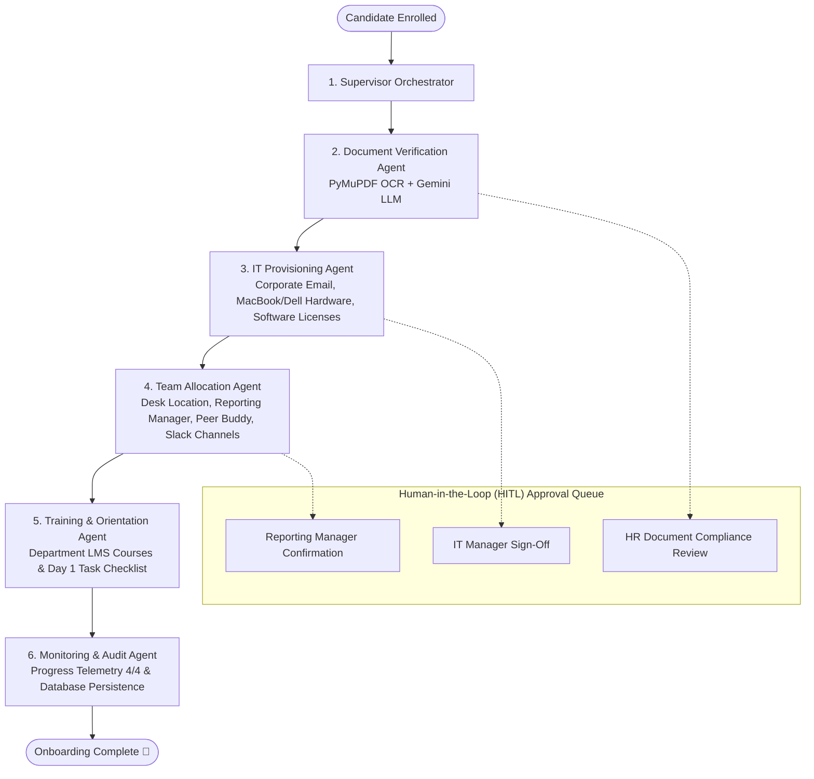

# EnterpriseFlow AI — Unified Multi-Agent Employee Onboarding Platform

A complete, production-ready, full-stack multi-agent employee onboarding system powered by **FastAPI**, **LangGraph**, **PyMuPDF**, and **React 19 (Vite)**.

This repository unifies 4 distinct feature modules into a single synchronized workflow with real-time orchestration, multimodal KYC document verification, automated IT provisioning, departmental team allocation, training LMS paths, and human-in-the-loop (HITL) approval gates.

---

## 🌟 Architecture & Consolidated Modules

```
all/
├── unified_onboarding/           # 🚀 The consolidated, working full-stack system
│   ├── backend/                  # FastAPI + LangGraph Multi-Agent Orchestrator
│   │   ├── agents/               # 5 specialized AI agents + Supervisor
│   │   ├── api/                  # REST API routes
│   │   ├── db/                   # SQLAlchemy ORM + Seed data (SQLite/PostgreSQL)
│   │   ├── services/             # OCR, Gemini LLM fallback, Mock APIs, Audit logger
│   │   └── uploads/              # Test KYC PDFs
│   ├── frontend/                 # React 19 + Lucide UI SPA (Vite)
│   ├── run_app.py                # Single runner serving API & UI on port 8000
│   └── requirements.txt
├── start_unified_app.bat         # ⚡ One-click launcher for Windows
│
├── aiflow/                       # Original Module: Frontend UI & Onboarding dashboards
├── document_verification/        # Original Module: PyMuPDF OCR & Gemini KYC agent
├── Hack4Hire (2)/                # Original Module: LangGraph backend & DB schema
└── It_team_training-main/        # Original Module: IT provisioning & team allocation specs
```

---

## 🤖 The Multi-Agent Workflow



---

## 🚀 Quick Start

### 1. One-Click Launch (Windows)
Double-click:
```bat
start_unified_app.bat
```

### 2. Manual Command Line
```powershell
cd unified_onboarding
.\.venv\Scripts\activate
python run_app.py
```

Open your browser:
* **Web Application**: [http://localhost:8000](http://localhost:8000)
* **Interactive Swagger API Docs**: [http://localhost:8000/docs](http://localhost:8000/docs)

---

## 🛠️ Tech Stack

- **Backend**: Python 3.12, FastAPI, Uvicorn, LangGraph, LangChain Core, PyMuPDF, Pydantic, SQLAlchemy.
- **Frontend**: React 19, Vite, Lucide React, Modern Dark Mode CSS.
- **AI & Vision**: Gemini API (`google-genai`), PyMuPDF OCR text engine, resilient rule-based extraction fallback.
- **Database**: SQLite (default zero-dependency) with seamless PostgreSQL support.
